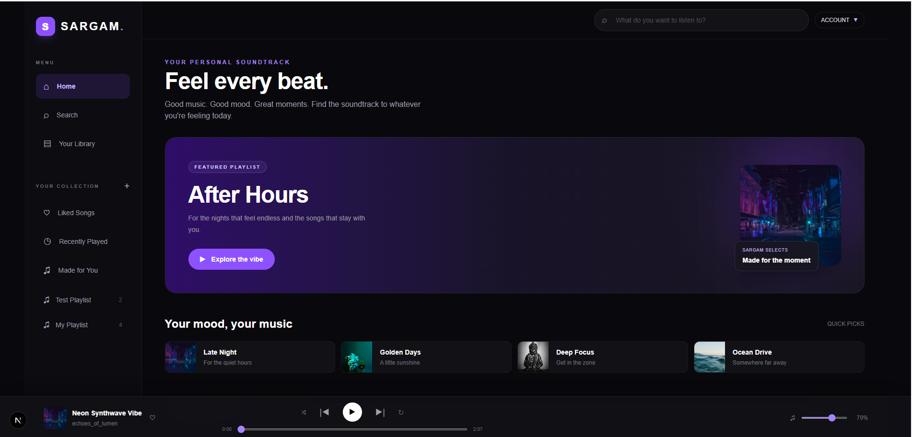
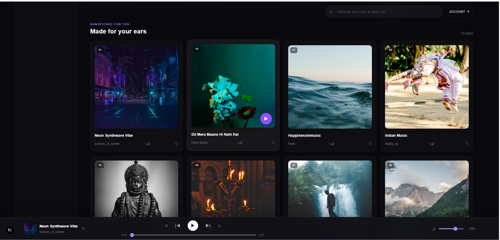
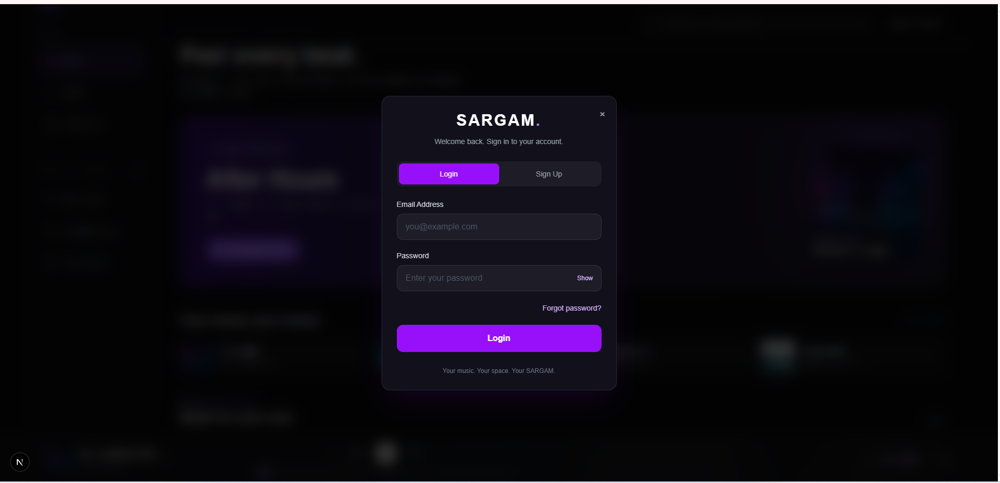
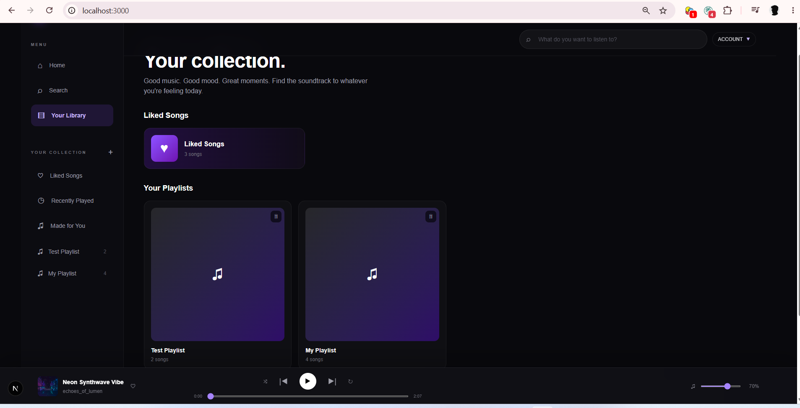
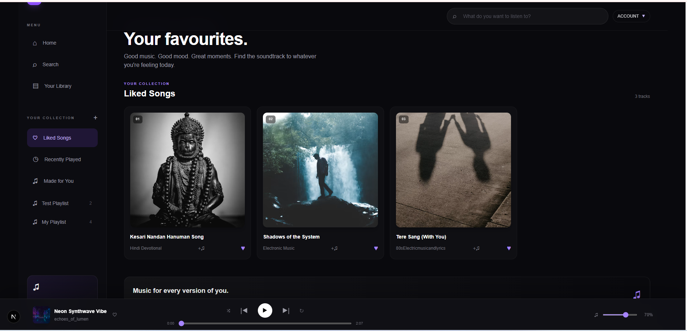
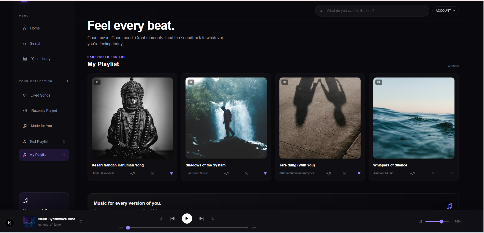

# 🎵 SARGAM — Your Music, Your Space.

A modern music streaming web application built to bring music, personalization, and a seamless listening experience together.

**SARGAM** is a music web application where users can explore music, play their favourite tracks, manage liked songs, and create personalized playlists — all through a clean and immersive interface.

<p align="center">
  <a href="https://github.com/rishi-devcodes/SARGAM">
    
  </a>
  
  
  
</p>

---

## ✨ Features

- **Music Player** — Play and control music through an interactive audio player.
- **User Authentication** — Sign up, log in, and securely manage your account.
- **Liked Songs** — Save your favourite tracks to your personal library.
- **Custom Playlists** — Create playlists, add songs, and delete playlists.
- **Personal Library** — Access your liked songs and created playlists.
- **Persistent Data** — User preferences and playlists are stored using Supabase.
- **Responsive Interface** — Designed to provide a smooth experience across different screen sizes.
- **Modern UI** — A dark-themed interface focused on simplicity and an immersive music experience.

## 🛠️ Tech Stack

| Technology | Purpose |
|---|---|
| Next.js 16 | React framework |
| React | UI development |
| TypeScript | Type-safe development |
| Tailwind CSS | Styling and responsive UI |
| Supabase | Authentication and database |
| HTML5 Audio | Music playback |
| Git & GitHub | Version control |

## 📸 Screenshots

## 📸 Screenshots

### 🏠 Home Page


### 🎧 Music Collection


### 🔐 Authentication


### 📚 Your Library


### ❤️ Liked Songs


### 🎵 Custom Playlists


## 🚀 Getting Started

Follow these steps to run SARGAM locally.

### 1. Clone the Repository

```bash
git clone https://github.com/rishi-devcodes/SARGAM.git
```

### 2. Navigate to the Project

```bash
cd SARGAM
```

### 3. Install Dependencies

```bash
npm install
```

### 4. Configure Environment Variables

Create a `.env.local` file in the root directory.

Add your Supabase credentials:

```env
NEXT_PUBLIC_SUPABASE_URL=your_supabase_project_url
NEXT_PUBLIC_SUPABASE_PUBLISHABLE_KEY=your_supabase_publishable_key
```

Get these values from your Supabase project's API settings.

**Important:** Never commit your actual `.env.local` file or expose secret service-role keys in client-side code.

### 5. Start the Development Server

```bash
npm run dev
```

Open [http://localhost:3000](http://localhost:3000) in your browser.

## 📁 Project Structure

```text
SARGAM/
│
├── public/
│   └── music/              # Local music assets
│
├── src/
│   ├── app/
│   │   └── page.tsx        # Main application page
│   │
│   ├── components/
│   │   └── AuthModal.tsx   # Authentication interface
│   │
│   ├── proxy.ts             # Application proxy
│   │
│   └── utils/
│       └── supabase/
│           ├── client.ts   # Supabase client
│           └── server.ts   # Supabase server client
│
├── .env.local              # Environment variables (not committed)
├── .gitignore
├── package.json
└── README.md
```

## 🗄️ Database

SARGAM uses Supabase for authentication and persistent user data.

The application uses the following database tables:

- `user_likes` — Stores songs liked by users.
- `playlists` — Stores user-created playlists.
- `playlist_songs` — Stores songs associated with playlists.

Row Level Security (RLS) policies help ensure that users can access and manage only their own library data.

## 🔮 Future Improvements

Some ideas for future development:

- Playlist editing and renaming.
- Improved music discovery and search.
- Enhanced listening history.
- More personalized recommendations.
- Additional player customization.

## 👨‍💻 Author

**Rishi Saxena**

B.Tech — Automation & Robotics  
GGSIPU

- GitHub: [@rishi-devcodes](https://github.com/rishi-devcodes)

---

<p align="center">
  Made with ❤️ and a passion for music.
  <br/>
  <strong>SARGAM — Every song has a story.</strong>
</p>